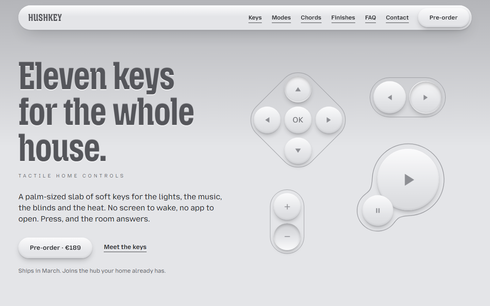
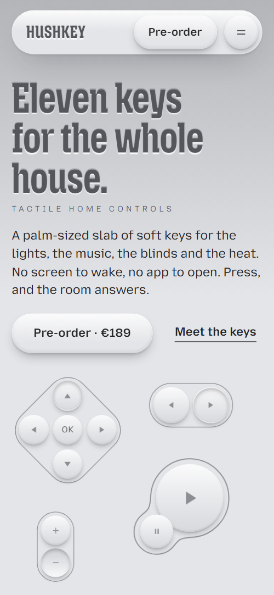
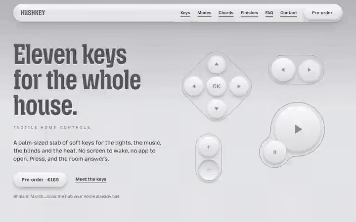

# Free HTML product landing page template with GSAP scroll animations

Product landing page template: a free one-page HTML site for launching a physical device, from the hero to two priced finishes, a FAQ and a contact form. The demo is a smart-home remote in soft tactile grey, drawn in HTML and CSS and shown one idea at a time. It is a single HTML file with an AGENTS.md, so Claude Code, Cursor or Codex can adapt it to your product.

[](LICENSE)   

**[Live demo](https://8bsite.github.io/product-landing-page-template/)** · **[Use this template](https://github.com/new?template_name=product-landing-page-template&template_owner=8bsite)** · **[Download ZIP](https://github.com/8bsite/product-landing-page-template/archive/refs/heads/main.zip)** · **[Template page on 8b.com](https://8b.com/templates/hushkey/)**

<a href="https://8bsite.github.io/product-landing-page-template/"></a> <a href="https://8bsite.github.io/product-landing-page-template/"></a>

<p align="center"><a href="https://8bsite.github.io/product-landing-page-template/"></a><br><sub>Scroll animation</sub></p>

## Use it with Claude Code, Cursor or Codex

Download the four files into your project folder (`curl.exe` in Windows PowerShell):

```bash
curl -LO https://raw.githubusercontent.com/8bsite/product-landing-page-template/main/index.html
curl -LO https://raw.githubusercontent.com/8bsite/product-landing-page-template/main/AGENTS.md
curl -LO https://raw.githubusercontent.com/8bsite/product-landing-page-template/main/LICENSE
curl -LO https://raw.githubusercontent.com/8bsite/product-landing-page-template/main/CREDITS.md
```

Then fill in the angle brackets and give your agent this prompt:

```text
Read AGENTS.md, then edit index.html. Turn this template into the launch page for <my product: what it is and who buys it, price for each finish, ship date or waitlist, battery, compatibility, payment and returns terms, contacts, studio town, the URL where people order>. Replace first the product name, the price and ship date, the key labels, the four mode captions, the three chords and the finish names. Keep the section ids, the classes AGENTS.md lists, each mode item's direction attribute, the two chord keys' size and position, and hero followed by states. Ask me for missing facts and never invent specs, prices, dates, certifications, reviews or contacts.
```

When you vibe code this page with Claude Code, Cursor or Codex, begin with a fact sheet from the maker: product name, price per finish, bundle price, ship date, battery life, compatibility, payment and returns terms, studio town and contacts. The demo versions of all of these are invented, so the agent should ask for each one and never guess a spec. Then relabel the toggle keys, the four mode captions and the three chords with your product's own functions. Leave the ids and the classes AGENTS.md lists in place, and set the footer wordmark's --len number to its new character count.

No agent? Click **[Use this template](https://github.com/new?template_name=product-landing-page-template&template_owner=8bsite)**, edit `index.html` on GitHub and turn on **Settings > Pages**.

## Sections and motion

- **Navigation**: top bar: wordmark, section links, Pre-order button; phone menu overlay.
- **First screen**: first screen: headline, two buttons, the eleven-key product panel drawn in HTML/CSS. Smooth scrolling runs page-wide; section headings press into the surface as they arrive. On load the headline lines settle and the keys swell in, and a pressed dent circles the pad's arrows while the hero is in view. Scrolling on sinks and shrinks the drawn panel while its keys press one by one.
- **Up is ready. Down is on.**: keyboard of seven toggle keys and an All off key (Up is ready / Down is on). Tied to scroll, the eight keys grow into place in a diagonal wave; a click toggles a key up or down, and All off lifts the rest.
- **One pad. Four moods of the house.**: sticky stage: D-pad drives four room photos (Morning, Desk, Evening, Away). Pinned while you scroll, the pad presses each direction in turn and each next room's photo wipes in from the same side.
- **Hold plus. The light arrives slowly.**: fader + plus key over one room photo (grey to colour on scroll). Tied to scroll, the room photo brightens from dark greyscale to full colour as the fader thumb travels to full.
- **No screen to wake.**: short statement: no screen, no app.
- **Press two at once. Get a third.**: two keys meet and their outlines melt into one (chords). Pinned while you scroll, the Lamp and Lock keys drift together until their outline melts into one shape, then Goodnight fades up.
- **Made to be found in the dark.**: three material cards with texture photos.
- **Two finishes. The same eleven keys.**: two finishes (Chalk, Graphite) with pre-order buttons and a switch. Each finish panel tilts upright from a steep backward lean as it scrolls in; at the section's end a single key presses down.
- **Before you press order.**: questions and answers (native &lt;details&gt;). The graphite background floods out of that key in a widening circle, tied to scroll, and the questions rise in.
- **Ask someone who has pressed every key.**: email, phone and a contact form (placeholders).
- **Footer**: width-filling HUSHKEY wordmark, links, copyright and the Design: 8B credit. Tied to scroll, the width-filling wordmark settles letter by letter, each letter brightening from muted grey as its shadow flips.

## Design

 page background, key faces  
 body text, shadows  
 highlights on keys and headings  
 hairline outlines and contour lines  
 embossed headings  
 upper edge of the hero gradient  
 graphite FAQ, contact and footer bands  
 muted text on graphite  
 deep shadows under graphite keys, buttons and headings

**Mozilla Headline**: headings: condensed, bold, very large, embossed. **Mozilla Text**: body and labels; small captions in spaced capitals (Google Fonts). Soft monochrome neumorphism: keys, buttons and photo frames rise from or press into one cool grey surface, and headings look stamped into it. The device is drawn in HTML and CSS from round keys and a rotated diamond, with SVG contour lines. Material photos are cut as a pill, a circle and a square.

## Questions

**What is a product landing page, and is this one built for hardware?**  
It is a page that presents one product and leads to one action, such as a pre-order or a waitlist sign-up. This one is built for a physical device: a hero, six sections that each show one idea, two priced finishes, six FAQ answers and a contact form, all in a single scroll.

**How to create a waitlist landing page from this template?**  
Point the Pre-order buttons at your sign-up form or waitlist service. The nav and hero buttons scroll to the finishes now, and the two finish buttons scroll to the contact form. Then replace the price and the ship date, and connect the contact form to Formspree or Netlify Forms, or remove it.

**Does the contact form send messages?**  
No. The form checks that the name, email and message are filled in and the email looks valid, then shows a thank-you line and sends nothing. Connect Formspree or Netlify Forms, or remove the form with its script and keep the email link. Also edit the promised reply within a working day, which is demo text.

## Is it the right base?

Pick this base when you sell a physical product and can explain it in a handful of ideas, each with a section of its own. For software, such as a SaaS product landing page, the [app](https://8b.com/templates/linea/) template is nearer, because this one shows a drawn object rather than screens. The weak spot is the hero: it is a panel of round keys and several animations press those keys, so a speaker, sensor or lamp means redrawing the panel, or using a product photo and dropping the key animations. The file has no cart, checkout or spec table.

## Before you publish

- Replace what is marked `data-8b-placeholder` (social preview image, favicon, email, phone, form) and the invented demo facts; [AGENTS.md](AGENTS.md) lists them.
- The form sends nothing yet: connect it to Formspree or Netlify Forms, or remove it.

## Tech

GSAP 3.13.0, ScrollTrigger, SplitText, Lenis 1.3.27 from jsDelivr, 115 KB, no build step. Chrome and Edge 111+, Safari 16.2+, Firefox 113+ (it uses color-mix(), container query units, cascade layers, small/dynamic viewport units). Lighthouse (mobile, measured by 8B before release): 93, LCP 2.7 s, CLS 0. With "reduce motion" on, the page is complete and still.

## License

MIT, see [LICENSE](LICENSE). Photos, fonts and libraries keep their own licences: [CREDITS.md](CREDITS.md). More free templates: [8b.com/templates](https://8b.com/templates/) · [github.com/8bsite](https://github.com/8bsite).
